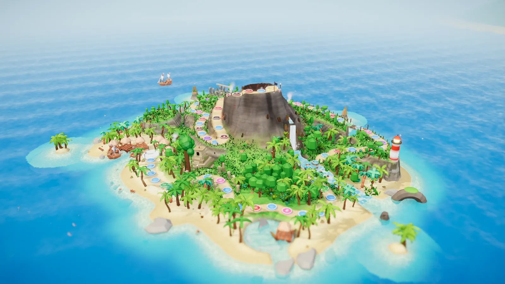
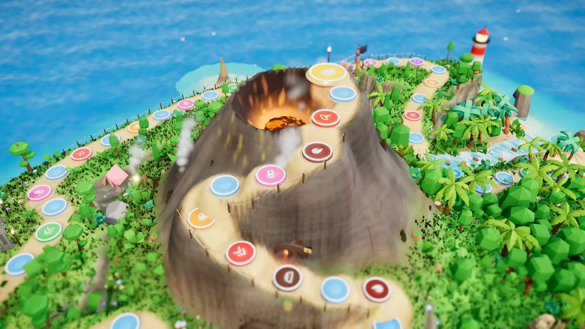
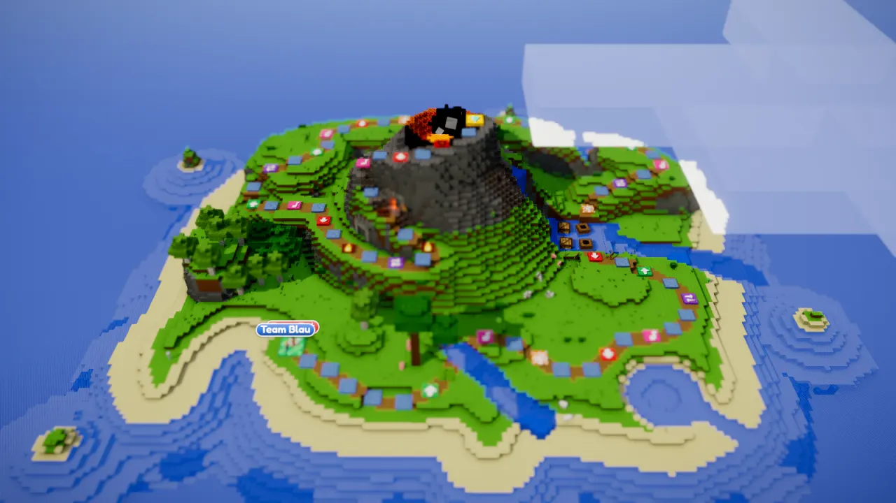
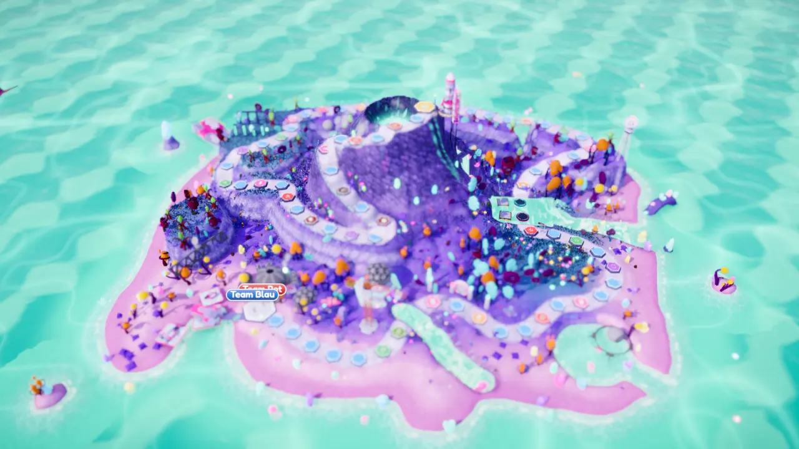
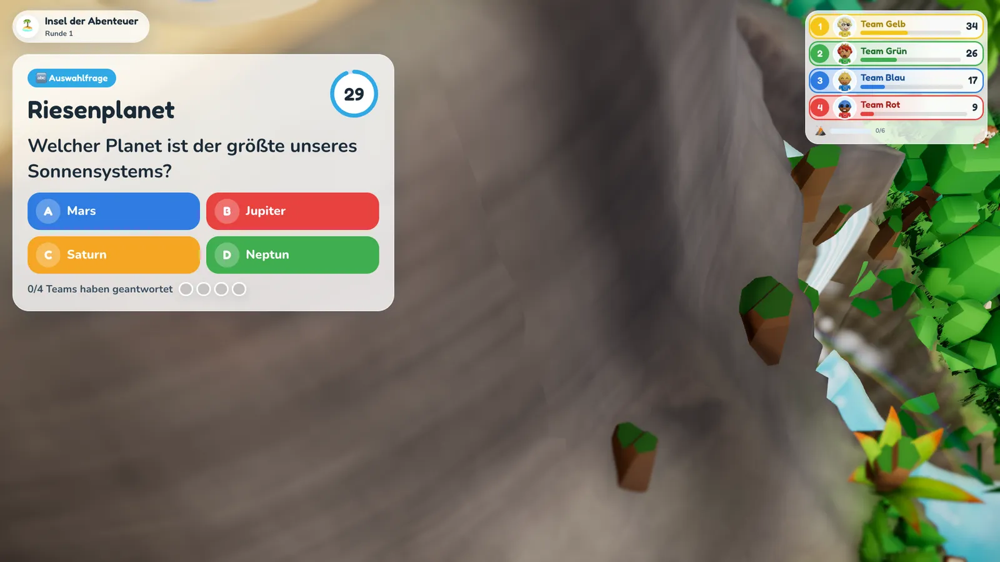
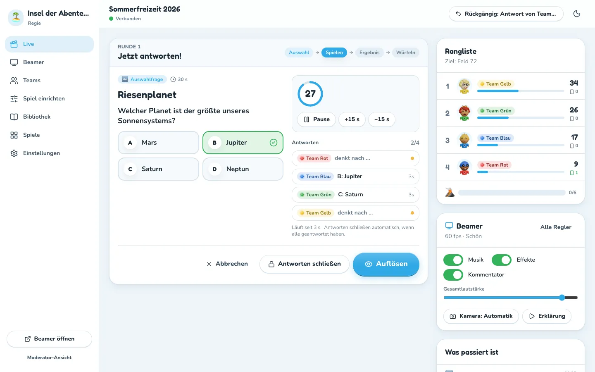
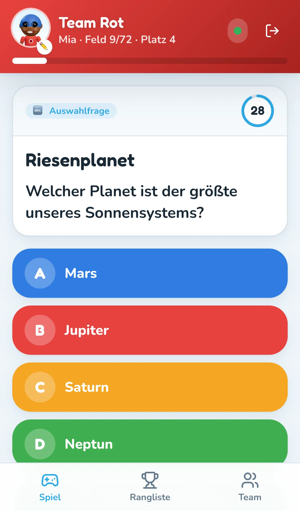

# 🏝️ Insel der Abenteuer

Ein Partyspiel für Gruppen im Stil von **Wii Party**: Die Teams wandern über eine 3D-Spielwelt bis zum Gipfel eines Vulkans. Wer welche Strecke würfeln darf, entscheiden Minispiele und Quizfragen, die live vor Ort gespielt werden. Gedacht für Jugendgruppen, Freizeiten, Klassenfahrten und Familienfeste mit **2–10 Teams** – gespielt wird mit **Handy, Tablet oder Laptop**, die Spielwelt läuft auf dem **Beamer**.



## Drei Welten – gleiche Regeln

Pro Spiel wählbar: Regeln und Spielfeld sind überall gleich, Optik, Figuren, Musik und Kommentator wechseln.

| 🏝️ Insel der Abenteuer | 🧱 Blockwelt | 🚀 Weltall |
|---|---|---|
|  |  |  |
| Tropische Vulkaninsel mit Dschungel, Wasserfall, Liane und Tieren | Alles aus Blöcken im Minecraft-Stil (eigene Pixel-Texturen), Mobs und der Nether im Vulkan | Bunter Alien-Planet mit Plasma-Meer, Mondbasis, Raketenrampe und Astronauten |

Unterwegs warten Sonderfelder mit eigenem Auftritt, Mutproben (über den Bach schwingen, Fässer oder Kisten, Lavahöhle, Kraterloch), das Innere des Vulkans und ein Vulkanausbruch. Ein gesprochener **Kommentator** begleitet das Spiel, die Musik wechselt je nach Phase, Wetter, Jahreszeit sowie Halloween und Weihnachten färben die Welt, und eine **Spielerklärung** mit Sprecher zeigt in gut drei Minuten, wie alles funktioniert.

## Die vier Bildschirme

| Wer | Was | Adresse |
|---|---|---|
| **Beamer** | 3D-Spielwelt mit Figuren, Fragen, Ergebnissen, Würfeln und Effekten – ohne Menü, komplett aus der Regie gesteuert | `/beamer` (Kiosk: `./start.sh beamer`) |
| **Regie** | Steuert den Abend: Spiel einrichten, Inhalte wählen, Antworten sehen, würfeln, Rückgängig, Beamer fernsteuern | `/regie` |
| **Moderator** | Große Vorleseansicht mit Lösungen – kann mitsteuern | `/moderator` |
| **Handys / Tablets** | Teams treten per QR-Code bei, antworten, buzzern, würfeln, gestalten ihre Figur | `/` → „Mitspielen“ |

| Beamer | Regie | Handy |
|---|---|---|
|  |  |  |

## Schnellstart

Voraussetzung: [Docker Desktop](https://www.docker.com/products/docker-desktop/) läuft.

```bash
cp .env.example .env        # dann ADMIN_PASSWORD in .env setzen
./start.sh                  # baut und startet alles, öffnet die Regie
```

Danach in der Regie (`http://localhost:9534/regie`) auf **Neues Spiel erstellen** – der Assistent führt durch Welt, Spieldauer, Spielfeld und Inhalte. Den Beamer mit `./start.sh beamer` öffnen; Handys scannen den QR-Code. Ausführlich: [Installation](docs/doku/guides/installation.md).

## Dokumentation

Die gesamte Doku liegt in [`docs/doku/`](docs/doku/) – Aufbau, Erklärung jeder Datei, Sicherheit, Abläufe, Entscheidungen und Anleitungen:

| Anleitung | Für wen |
|---|---|
| [Installation](docs/doku/guides/installation.md) | Technik: Laptop mit Docker |
| [Betrieb](docs/doku/guides/serverbetrieb.md) | Technik: VPS, Cloudflare-Tunnel, Spielabend, Sicherheit |
| [Aktualisieren](docs/doku/guides/aktualisieren.md) | Technik: neue Version einspielen |
| [Notfall & Fehlerbehebung](docs/doku/guides/notfall.md) | Technik: Störungen, Passwort vergessen, Backup |
| [Spieleabend durchführen](docs/doku/guides/spielleitung.md) | Regie & Moderator |
| [Spielregeln](docs/doku/guides/spielregeln.md) | Alle |
| [Inhalte erstellen](docs/doku/guides/inhalte.md) | Vorbereitung: Spiele, Fragen, Import/Export |
| [Entwicklung](docs/doku/guides/entwicklung.md) | Entwickler: lokal starten, Tests, Werkzeuge |
| [Umstieg von Version 1](docs/doku/guides/umstieg.md) | Was aus der alten Flask-Version wurde |

Überblick über das ganze System in wenigen Zeilen: `node .claude/doku/doku.mjs summary` (Details zu einem Baustein: `… show <id>`).

## Technik in Kürze

TypeScript-Monorepo: **Spiel-Engine** (reine Logik, getestet, von Server und Browser gemeinsam genutzt) · **Server** (Fastify, Socket.IO, SQLite) · **Weboberfläche** (React, Tailwind, three.js). Alle Bibliotheken und Assets liegen lokal – das Spiel funktioniert auch ohne Internet. 3D-Modelle, Texturen, Himmel, Geräusche und die Musik von Blockwelt und Weltall sind frei lizenziert (überwiegend CC0, einige Tiere CC-BY); Insel-Musik, Effekte und Sprecher wurden für das Projekt mit ElevenLabs erzeugt – siehe [Lizenzen](packages/web/public/assets/LICENSES.md).

Die ursprüngliche Flask-Version (v1) liegt im Ordner [`legacy/`](legacy/) und in der Git-Historie.
