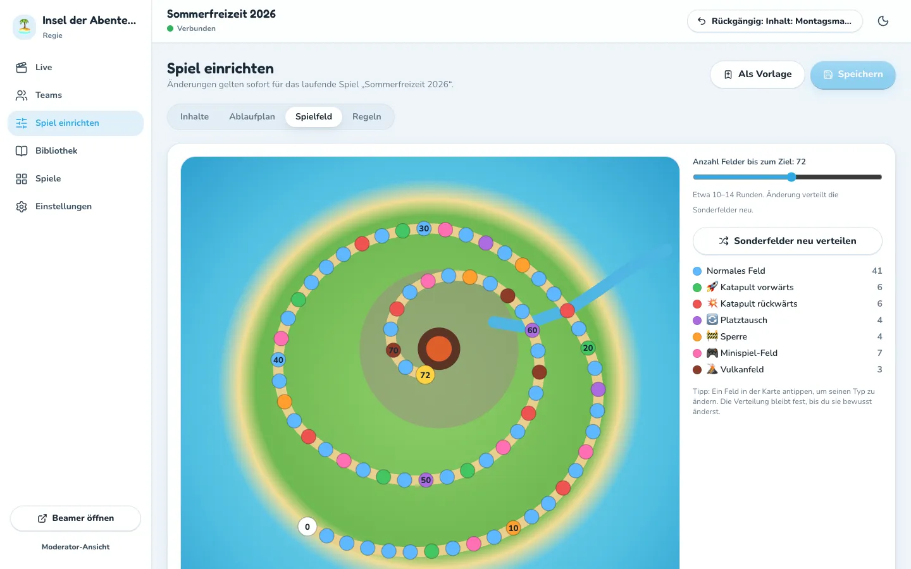
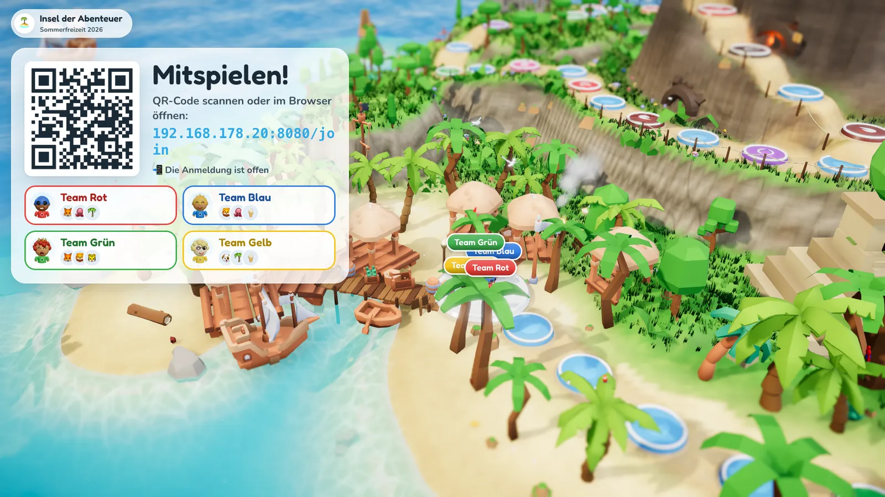
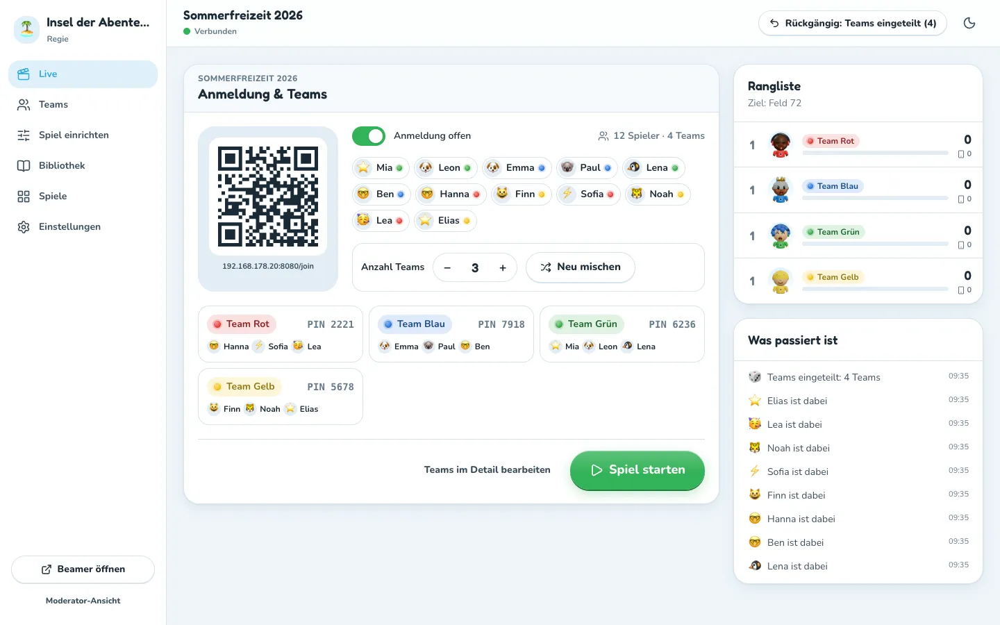
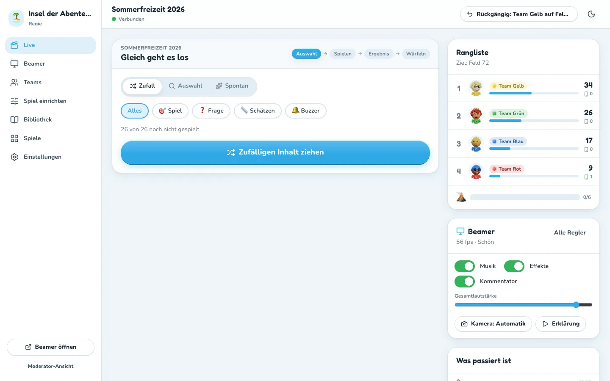
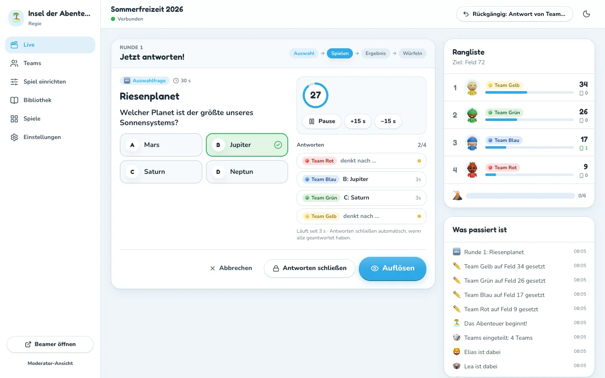
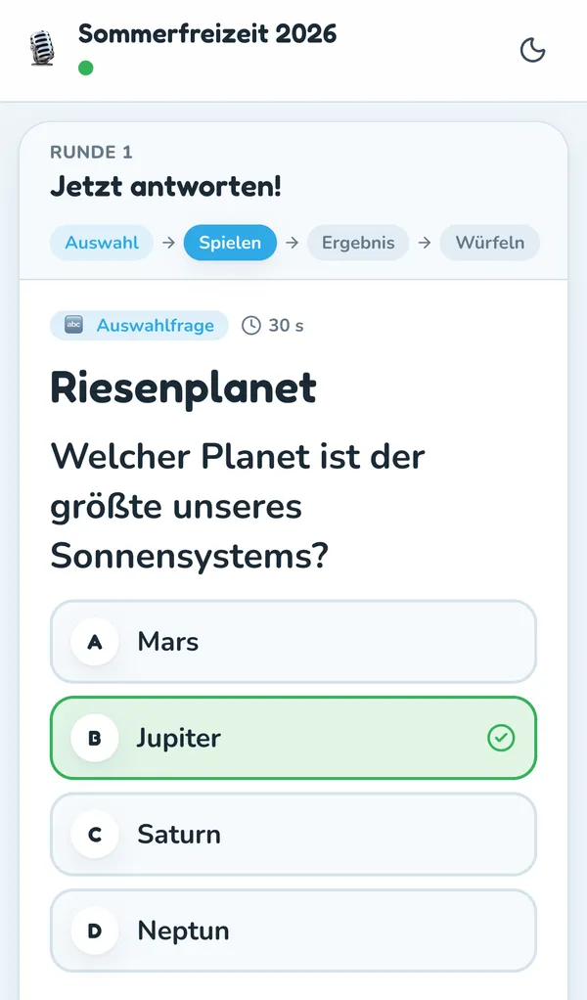
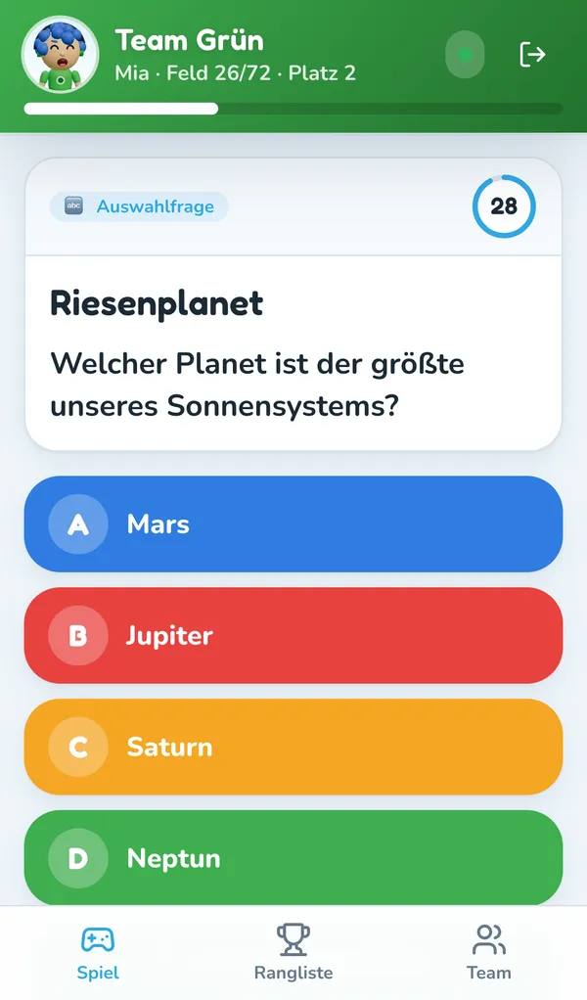
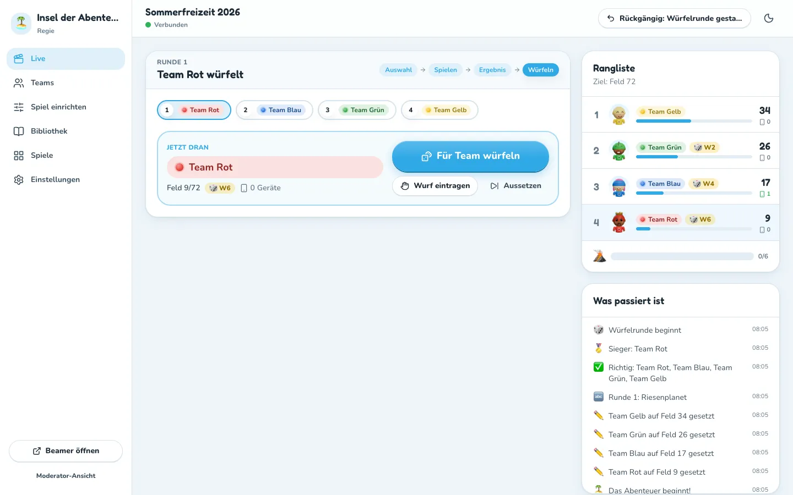
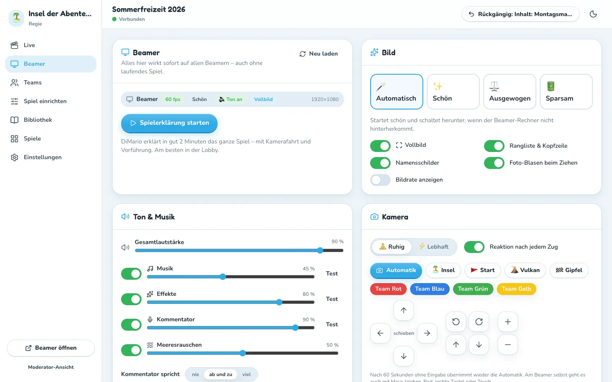

# Spieleabend durchführen

Diese Anleitung ist für die beiden Personen, die den Abend leiten:

- **Regie** (Technik): sitzt am Laptop, steuert alles in der Regie-Ansicht.
- **Moderator** (Vorleser): steht vorne, liest Fragen und Regeln vor, sieht die Lösungen auf dem Handy oder Tablet und kann ebenfalls steuern.

Beide arbeiten gleichzeitig am selben Spiel. Wer zuerst klickt, gewinnt – die Ansichten aktualisieren sich sofort.

## Vorher (am Vortag oder vor Ort)

1. **Laptop vorbereiten**: Docker Desktop starten, im Projektordner `./start.sh` ausführen. Die Regie öffnet sich im Browser.
2. **Anmelden**: Spielleiter melden sich in der Regie mit **E-Mail und Passwort** an (Konto vom Admin, siehe [Spielleiter-Konten](#spielleiter-konten-und-mehrere-spiele)). Der Admin gibt als Benutzernamen `admin` ein und dazu das Passwort aus der Datei `.env` (`ADMIN_PASSWORD`).
3. **Inhalte prüfen**: Unter *Bibliothek* die Sammlungen ansehen, ggf. eigene Spiele und Fragen anlegen (siehe [Inhalte erstellen](inhalte.md)).
4. **Spiel anlegen**: Unter *Live* (ohne Spiel) oder *Spiele* auf **Neues Spiel erstellen** – mehr nicht. Das Spiel entsteht sofort (Name „Spieleabend <Datum>“, Standard-Vorlage), danach geht es direkt in die **geführte Einrichtung**. Eine eigene Vorlage lässt sich dort auf der ersten Folie übernehmen (*Von einer gespeicherten Vorlage starten*). Solange dein Spiel läuft, gibt es den Knopf nicht – erst beenden oder unter *Spiele* schließen. Jedes Spiel bekommt einen **Spielcode** (z. B. `KX7P`) – er steht oben in der Regie und steckt in allen QR-Codes.
5. **Spiel einrichten – geführt** (*Spiel einrichten → Geführt*, vor dem Spiel die Standardansicht): Folie für Folie, nichts gilt, bevor du am Ende **Übernehmen** drückst. Oben siehst du alle Schritte und kannst zu bereits besuchten zurückspringen.
   - **Welt**: *Insel der Abenteuer*, *Blockwelt* oder *Weltall* (siehe [Welten](#welten-insel-blockwelt-oder-weltall)).
   - **Spieldauer**: wie lange ungefähr gespielt wird und mit wie vielen Teams. Der Assistent schlägt Länge und Sonderfelder vor – kurze Spiele mit weniger Bremsen und Minispielen, lange Abende mit mehr Minispielen und Platztausch. Ein Algorithmus (Spiel-Tempo, siehe unten) hält die Zeit danach unauffällig ein. Der Vorschlag plant ein leicht beschleunigtes Tempo ein (z. B. 50 Minuten, 4 Teams → ca. 46 Felder), das Tempo hat trotzdem nach beiden Seiten Luft.
     - *Spieldauer überspringen*: alles selbst festlegen, **reine Zufallswürfe ohne Spiel-Tempo** – keine Algorithmen, die das Spiel beeinflussen, keine Tempo-Knöpfe. „Doch eine Spieldauer festlegen“ holt sie zurück.
   - **Spielfeld**: Anzahl Felder eintippen oder schieben; daneben die Insel als Vorschau und wie lange das Spiel damit dauert (mit Spieldauer auch, ob es zur Wunschzeit passt – sonst ein Knopf, der die Länge anpasst).
   - **Sonderfelder**: jedes Sonderfeld *Aus / Selten / Normal / Oft / Sehr oft* – mit Anzahl und Live-Vorschau. Die Mutproben der Insel (Liane, Fässer oder Kisten, Lavahöhle, Kraterloch, Vulkanausbruch) an- oder ausschalten. Die Häufigkeiten bleiben gespeichert, auch wenn du später die Länge änderst oder neu verteilst.
   - **Was kommt dran?**: Spiele, Auswahl-, Freitext-, Schätz- und Buzzer-Fragen an- oder abwählen. Das gilt für den Zufall; im Ablaufplan und bei der Auswahl von Hand bist du frei. Feld-Minispiele kommen weiter über die Minispiel-Felder.
   - **Sammlungen**: Sammlungen wählen (aufklappen zeigt die passenden Inhalte). Unten steht, ob die Inhalte für die erwarteten Runden reichen.
   - **Handys & Sieg**: eigenes Handy oder Gruppen-Gerät, Siegbedingung.
   - **Fertig**: Übersicht mit *Ändern* je Punkt, Name des Spiels, **Übernehmen**.
6. **Alle Einstellungen** (optional, für Feinheiten): links (am Handy oben als Leiste) die Bereiche, rechts die Einstellungen dazu. Unten blättert man zum nächsten Bereich.

   | Gruppe | Bereich | Inhalt |
   |---|---|---|
   | Grundlagen | Name & Handys | Name des Spiels, eigenes Handy oder Gruppen-Gerät |
   | | Welt & Stimmung | **Welt** (Insel oder Blockwelt) und darunter **Wetter, Jahreszeit, Festzeit** (siehe unten) |
   | | Spieldauer | Wunschdauer bzw. Spiel beschleunigen/verlangsamen (wie auf der Live-Seite) |
   | Inhalte | Was kommt dran? | Arten, die per Zufall drankommen, und die Sammlungen |
   | | Ablaufplan | feste Reihenfolge von Spielen/Fragen per Drag & Drop |
   | Spielfeld & Regeln | Spielfeld | Länge, Sonderfelder neu verteilen oder einzeln antippen. Liane/Ranke, Fässer oder Kisten, Lavahöhle und Kraterloch sind feste Stationen („fest“). |
   | | Würfel & Sieg | Bonuswürfel nach Platz, Siegbedingung |
   | | Sonderfelder | Katapulte, Platztausch, Sperre, Feld-Minispiele |
   | | Mutproben | Liane/Ranke, Fässer oder Kisten, Lavahöhle, Kraterloch – je an/aus und wie schwer |
   | | Vulkan (Blockwelt: Vulkan & Nether) | Druck, Gefahrenzone, Rückschlag, Vulkan-Inneres/Nether und Strafweg |
   | | Fragen & Antworten | Bonus nur für richtige Antworten, automatisch schließen |

   Die Namen richten sich nach der Welt (Blockwelt: Ranke, Nether, Schleimblock, Knaller, Teleport-Perle, Spinnennetz). Änderungen merkt sich die Seite, auch beim Wechsel zwischen den Bereichen (Punkt an geänderten Bereichen). Sobald etwas geändert ist, erscheint unten eine Leiste **Ungespeichert · … – Verwerfen / Speichern**; erst *Speichern* ändert das Spiel. Ausnahme: Wetter & Stimmung und Spieldauer wirken sofort (so markiert). Mit **Als Vorlage** lässt sich alles für spätere Abende sichern.

   
7. **Beamer**: Am besten mit `./start.sh beamer` öffnen – das startet Chrome/Edge als Kiosk im Vollbild, Ton läuft sofort, und der Beamer ist gleich freigegeben. Alternativ `/beamer` im Browser öffnen (Knopf *Beamer öffnen* in der Regie), auf den Beamer ziehen und **einmal hineinklicken** (Browser geben Ton und Vollbild erst nach einem Klick frei). Läuft der Beamer auf einem anderen Rechner, zeigt er unten rechts einen **sechsstelligen Code** – in der Regie unter *Beamer* eingeben und *Freigeben* (erst dann zeigt er Fotos, QR-Code mit WLAN-Adresse und Verlauf). Am Beamer gibt es kein Menü mehr – **alles steuert die Regie unter *Beamer*** (siehe unten), auch bevor das Spiel startet.
8. **Moderator verbinden**: *Einstellungen → Moderator-QR-Code erzeugen* – mit dem Handy der vorlesenden Person scannen. Kein Passwort nötig. (Alternativ unter `/moderator` Spielcode + Moderator-Passwort.)
9. **Material** für die Spiele bereitlegen (steht bei jedem Spiel unter „Material“).

## Ankommen: Anmeldung & Teams

1. Der Beamer zeigt automatisch die **Lobby** mit großem QR-Code.

   

2. Alle scannen den QR-Code mit dem Handy (er enthält den Spielcode – wer ohne QR-Code auf die Seite kommt, tippt den Spielcode ein), geben ihren **Vornamen** ein, wählen ein **Emoji** und machen optional ein **Selfie**. (Die Fotos erscheinen später, wenn jemand für ein Spiel ausgelost wird.)
3. In der Regie unter *Live* die **Anzahl Teams** wählen (2–10) und **Teams bilden** klicken. Die Spieler werden zufällig und gleichmäßig verteilt. *Neu mischen* geht jederzeit vor Spielbeginn.
4. Feinarbeit unter *Teams*: Namen und Farben ändern, Spieler per Auswahlfeld verschieben, Fotos tauschen, Spieler von der Auslosung ausnehmen (z. B. bei Verletzung).
5. Die Handys wechseln automatisch zur Team-Ansicht. Solange das Spiel noch nicht läuft, steht dort groß **„Gestaltet euer Team!“**: Teamname ändern und Spielfigur gestalten (Haare, Gesicht, Zubehör – das Shirt hat immer die Teamfarbe). Der Beamer zeigt Änderungen sofort. Später geht das jederzeit unter *Team* oder per Tipp auf die Figur oben links.
6. Wer kein eigenes Handy hat: Ein Team-Handy reicht. Weitere Geräte treten mit der **Team-PIN** bei (steht in der Regie und auf den Team-Handys). Unter *Teams → QR-Codes drucken* gibt es eine Druckseite mit QR-Code und PIN pro Team.
7. **Spielerklärung** (empfohlen): Regie → *Beamer* → **Spielerklärung starten**. Der Kommentator erklärt in gut drei Minuten das ganze Spiel – Mitspielen mit Handy, Tablet oder Laptop, Doppeltipp zum Abschicken, Sonderfelder, Mutproben und das Vulkan-Innere – mit Kamerafahrt über die Insel, Vorführungen genau zum gesprochenen Satz und Untertiteln.
8. **Spiel starten**. Die Anmeldung schließt sich automatisch; Nachzügler kommen mit der Team-PIN rein.

## Spiel-Tempo: Spieldauer und „schneller/langsamer“

**Vor dem Spiel** steht in der Regie (Live, rechts) und beim Moderator die Karte **Spieldauer**: *Ohne Vorgabe*, 30–120 Minuten oder eine eigene Zahl (am bequemsten gleich in der geführten Einrichtung). Darunter steht, wie lange das gewählte Spielfeld mit den aktuellen Teams ohne Vorgabe ungefähr dauert. Ist die Wunschzeit für das Spielfeld zu knapp (oder zu lang), sagt die Karte, was unauffällig machbar ist – für deutlich kürzere Spiele ein kürzeres Spielfeld wählen (*Spiel einrichten*). Mit *Ohne Spiel-Tempo spielen* (bzw. *Spieldauer überspringen* in der Einrichtung) ist das Tempo ganz aus: reine Zufallswürfe, keine Tempo-Knöpfe; *Spieldauer vorgeben* schaltet es wieder ein.

**Während des Spiels** zeigt die Karte **Spiel-Tempo**, wie lange schon gespielt wird, wie lange es voraussichtlich noch dauert (mit Uhrzeit fürs Ende) und ob es im Plan liegt. Mit **Spiel beschleunigen** bzw. **Spiel verlangsamen** öffnet sich ein Fenster: mit Spieldauer „5/10/15/20 Minuten früher bzw. später“ oder eine neue Gesamtdauer, ohne Spieldauer „etwas“ oder „deutlich“ schneller/langsamer. *Normales Tempo* setzt alles zurück.

So funktioniert es – fair und für die Teams unsichtbar:

- Zu Beginn jeder Würfelrunde legt das Spiel ein Tempo fest, das für **alle Teams gleich** gilt. Es hängt nur von Spielzeit und Gesamtfortschritt ab, nie davon, wer vorne liegt.
- Bei schnellem Tempo zeigen die Würfel (auch Bonuswürfel, Liane, Lavahöhle, Siegeswurf) etwas öfter hohe Augen – im Schnitt ca. 4,4 statt 3,5, jede Zahl bleibt möglich –, und Fässer/Kisten brechen seltener ein, Katapulte werfen etwas weiter vor und weniger weit zurück. Bei langsamem Tempo umgekehrt.
- Handys und Beamer bekommen Spieldauer und Tempo gar nicht erst zu sehen; im Verlauf steht nichts davon. Echte Würfe, die die Regie einträgt, bleiben unverändert.
- Unauffällig lässt sich ein Spiel so um etwa ein Drittel verkürzen oder um ein Viertel verlängern (Standard-Spielfeld mit 72 Feldern: ca. 60–115 statt ca. 90 Minuten). Die Prognose lernt aus den gespielten Runden mit (Rundendauer, Vorankommen).

## Welten: Insel, Blockwelt oder Weltall

Jedes Spiel hat eine **Welt** (*Spiel einrichten* → erste Folie bzw. *Alle Einstellungen → Welt & Stimmung*). Regeln, Spielfeld und Ablauf sind in allen gleich – nur Optik, Begriffe, Musik und Sprüche wechseln (Verlauf, Handys, Regie und Beamer nennen die Mutproben und Sonderfelder jeweils beim Namen der Welt):

- **Insel der Abenteuer**: tropische Vulkaninsel (Standard).
- **Blockwelt** (Minecraft-Stil, alles mit eigenen Pixel-Texturen gezeichnet): Die Insel besteht aus Blöcken – Gras, Erde, Stein, Sandstrände, Kiesweg, Wasserfall und Fluss als Wasserblöcke, Eichen-, Birken- und Dschungelbäume, Blumen. Die Felder sind Woll-Platten mit Pixel-Symbolen (Start: Smaragd, Ziel: Gold mit Diamant). Figuren sind Kastenmännchen aus denselben Editor-Einstellungen (Hemd = Teamfarbe). Auf den Wiesen grasen Schafe, Kühe, Schweine und Hühner, in den Wäldern streifen Zombies und Skelette, an der Höhle Spinnen und Fledermäuse, am Wasser hüpfen Schleime, am Vulkanfuß schleichen Knaller.
  - Sonderfelder als Mobs/Blöcke: *Katapult vorwärts* = Schleimblock schleudert, *Katapult rückwärts* = ein **Knaller** schleicht heran, zischt und sprengt das Team zurück, *Platztausch* = Teleport-Perle, *Sperre* = Spinnennetz mit Spinne, *Minispiel* = Notenblöcke mit Leuchtfeuer, *Totenkopf* = der Boden bricht weg.
  - Mutproben: Eiche mit **Ranke** über den Bach, Fass- und Kistenblöcke am Wasserfall, Höhleneingang aus Bruchstein.
  - **Vulkan-Inneres = Nether**: Netherrack-Höhle mit Glowstone, Lavasee und Lavafällen, Strafweg über Netherziegel-Pfeiler, Ausgangsfeld als Glowstone mit Leuchtfeuer, Ausgang durch ein Obsidian-Portal, darüber schweben Glutgeister.
  - Handys und Beamer-Einblendungen bekommen den Pixel-Look (Pixelschrift für Überschriften und Knöpfe, graue Menü-Kästen, Erd-Hintergrund). Fragen, Antworten, Lösungen und Zahlen stehen in einer klar lesbaren, kantigen Schrift (Chakra Petch), damit sich nichts verwechseln lässt (2/Z, 5/S, 8/B). Die Regie bleibt wie gewohnt.
  - Eigene Kommentator-Sprüche (Knaller, Teleport-Perle, Spinnennetz, Ranke, Nether …), eigene Spielerklärung und eigene ruhige Musik (freie Stücke im Blockspiel-Stil, im Nether düster).
- **Weltall** (bunter Alien-Planet im Low-Poly-Stil): violette und türkise Böden, rosa Strände, ein leuchtendes Plasma-Meer, Plasma-Fluss und -Wasserfall. Leuchtbäume, Kristalle, Pilze, eine Mondbasis mit Kuppeln, Landeplattformen und Raumschiffen, am Himmel ein Ringplanet und zwei Monde. Die Felder sind leuchtende Sechseck-Plattformen (Start: Landeplatz, Ziel: goldene Plattform an der **Raketenrampe** auf dem Gipfel). Gespielt wird im **Astronautenanzug** in Teamfarbe mit Glashelm – Gesicht, Frisur und Zubehör aus dem Figuren-Editor sind im Helm zu sehen.
  - Sonderfelder: *Katapult vorwärts* = **Jetpack**, *Katapult rückwärts* = **Schwarzes Loch**, *Platztausch* = **Teleporter**, *Sperre* = **Energiekäfig**, *Totenkopf* = **Wurmloch**.
  - Mutproben: **Greifhaken** über den Plasma-Bach, **Kapseln oder Kisten** am Plasmafall, **Kristallhöhle** statt Lavahöhle, Kraterloch.
  - **Alien-Vulkan**: Plasma im Krater; beim Ausbruch fliegen Kristallbrocken und Meteoriten mit Leuchtspur. Das Innere ist die **Alien-Höhle** (Strafweg über Kristallinseln, Ausgang per Teleporter).
  - Bewohner: kleine Aliens, Roboter-Drohnen und andere Wesen.
  - Wetter wird zu Sporenregen, Kristallstaub, Ionensturm mit violetten Blitzen und Staubdunst; Halloween mit Kürbis-Kapseln und Geister-Aliens, Weihnachten mit Kristallbäumen und Lichterketten an der Basis.
  - Handys und Beamer-Einblendungen: dunkler Sternenhimmel-Look mit Neon-Akzenten (Überschriften in Exo 2), Fragen bleiben in der gut lesbaren Standardschrift.
  - Eigene Kommentator-Sprüche und Spielerklärung (vertont) sowie eigene freie Musik (Weltraum-Synth, in der Höhle geheimnisvoll, eigenes Finale).

## Wetter, Jahreszeit und Festzeit

Unter *Spiel einrichten → Alle Einstellungen → Welt & Stimmung* (gilt für beide Welten und für alle Beamer deines Kontos, wirkt sofort; auf der Seite *Beamer* steht ein Verweis mit dem aktuellen Wetter):

- **Wetter**: *Automatisch* oder fest Sonne, Wolken, Regen, Gewitter (Blitze mit Donner), Schnee, Nebel.
- **Jahreszeit**: *Nach Datum* oder fest. Herbst färbt das Laub, im Winter liegt Schnee.
- **Festzeit**: *Nach Datum* (Halloween 17.10.–2.11., Weihnachten 1.–26.12.) oder fest Normal/Halloween/Weihnachten.
  - *Halloween*: Dämmerung und Nebel, Kürbislaternen am Weg, kleiner Friedhof am Start, Gespenster am Vulkanhang, Fledermäuse um den Gipfel, Mond.
  - *Weihnachten*: Schneefall und Schneedecke, geschmückte Tannen am Weg, bunte Lichterkette entlang des Wegs, Geschenke an Start und Ziel, Schneemann.

Die Automatik passt sich dem Spiel an: Die Jahreszeit bestimmt die Grundstimmung, alle paar Runden wechselt das Wetter (auf allen Beamern gleich). Hoher Vulkandruck zieht dunkle Wolken auf, im Finale wird es dramatisch (Gewitter bzw. Schneetreiben), beim Sieg reißt der Himmel auf. Die Karte zeigt, was gerade auf dem Beamer zu sehen ist. Zum Ausprobieren am Beamer: `?weather=snow&season=winter&festive=christmas`.

## Spielleiter-Konten und mehrere Spiele

Auf einem Server können mehrere Spielleiter gleichzeitig eigene Spiele leiten:

- **Admin** (Passwort aus `.env`, oder ein Konto mit Admin-Rolle): lädt unter *Konten* Spielleiter per E-Mail ein, sieht live, wer gerade online ist (grüner Punkt, sonst „zuletzt online vor …“), sperrt Konten, meldet sie überall ab, schickt Links zum Passwort-Zurücksetzen, sieht und verwaltet **alle Spiele** (*Spiele → Spiele der Spielleiter*) und stellt unter *Einstellungen* Namen, Beitritts-Adresse und **E-Mail-Versand (SMTP)** ein.
- **Spielleiter**: bekommen eine Einladungsmail, legen über den Link ihr Passwort fest und sehen nur **ihre eigenen Spiele**. „Passwort vergessen?“ steht auf der Anmeldeseite.
- **Mehrere Spiele gleichzeitig:** Jedes Spiel hat seinen eigenen Spielcode; Handys landen über den QR-Code bzw. den Code im richtigen Spiel. Unter *Spiele* lässt sich ein Spiel **wählen** (Regie und eigene Beamer zeigen es), **schließen** (niemand kommt mehr hinein, der Spielstand bleibt) oder löschen.
- **Beamer** gehören dem Konto, das sie freigegeben hat, und zeigen immer dessen gewähltes Spiel – einmal koppeln reicht für alle künftigen Abende.
- **Bibliothek:** Eigene Sammlungen sieht nur ihr Besitzer – bis er sie mit dem Schalter **für alle veröffentlicht**. Gemeinsame Sammlungen (vom Admin oder veröffentlicht) kann jeder in seine Spiele nehmen; ändern lassen sie sich erst nach **„Als eigene Kopie übernehmen“**. Der Admin pflegt alle Sammlungen.

## Eine Runde

Jede Runde hat vier Schritte – oben in der Regie als Leiste sichtbar: **Auswahl → Spielen → Ergebnis → Würfeln**.

### 1. Auswahl

Wähle den nächsten Inhalt:

- **Plan**: nächster Punkt aus dem Ablaufplan.
- **Zufall**: ein noch nicht gespielter Inhalt – auf Wunsch nur Spiele, nur Fragen, nur Schätz- oder Buzzer-Fragen.
- **Auswahl**: Liste mit Suche, Vorschau und Häkchen bei bereits Gespieltem.
- **Spontan**: schnell eine eigene Frage oder ein Spiel eintippen (wird nicht gespeichert).

Bei Spielen werden sofort die **Spieler ausgelost** (fair: wer seltener dran war, kommt zuerst). Mit „neu“ kann pro Team neu gelost werden.

### 2. Spielen

- **Fragen**: *Antworten freigeben* – der Countdown läuft, die Handys zeigen große Antwortknöpfe. Auf dem Beamer erscheint die Frage zuerst groß in der Bildmitte (mit Aufnahme wird sie vorgelesen) und wandert dann in die Tafel oben links. Hat die Frage eine Aufnahme, zeigen Regie und Moderator „Der Beamer liest diese Frage vor“ mit dem Knopf **Nochmal vorlesen**. In der Regie siehst du live, wer was geantwortet hat. Haben alle geantwortet, schließt die Runde automatisch. Dann **Auflösen**.
  - *Freitext* wird tolerant bewertet (Groß-/Kleinschreibung, Umlaute, Artikel, kleine Tippfehler). Mit ✓/✗ kannst du jede Antwort per Hand werten.
  - *Schätzfrage*: Wer am nächsten dran ist, gewinnt; gleicher Abstand = gleicher Platz.
  - *Buzzer*: Die Handys zeigen einen großen roten Knopf. Die Reihenfolge erscheint sofort; bewerte das erste Team mit *Richtig* oder *Falsch* – bei Falsch ist das nächste dran.
- **Spiele**: *Spiel starten* (optional mit Countdown), dann die **Platzierung eintippen**: Teams in der Reihenfolge ihres Platzes antippen. Für Gleichstand vorher *= Gleichstand* drücken. Nochmal antippen entfernt ein Team.

| Regie | Moderator | Handy | Beamer |
|---|---|---|---|
|  |  |  |  |

**Auflösen:** Der Beamer zeigt die richtige Antwort ein paar Sekunden groß in der Mitte – mit den Teams, die richtig lagen (bei Schätzfragen: wer am nächsten dran war). Auf den Handys erscheint groß „Richtig!“ (grün) oder „Leider falsch“ (rot) mit der richtigen und der eigenen Antwort. Regie und Moderator sehen oben **Zum Vorlesen** – die Erklärung aus der Notiz der Frage (die Wissensmix-Fragen haben dort einen kurzen Hintergrund).

**Moderator-Handy:** Während eines Spiels geht der Bildschirm nicht aus (Anzeige „bleibt an“ oben). Browser erlauben das nur über eine sichere Verbindung – mit `./start.sh online` (https) oder am Rechner selbst; im reinen WLAN-Betrieb (http) bitte die automatische Sperre am Handy hochsetzen.

### 3. Ergebnis

*Ergebnis zeigen* – der Beamer zeigt die Plätze und die **Bonuswürfel** (Standard: 1. Platz W6, 2. Platz W4, 3. Platz W2; bei Fragen nur für richtige Antworten).

### 4. Würfeln

*Würfelrunde starten*. Die Teams würfeln in der Reihenfolge ihrer Platzierung **am Handy** („Würfeln!“). Auf dem Beamer rollt der 3D-Würfel, die Figur läuft, Sonderfelder lösen aus.

- Die Regie kann **für ein Team würfeln** (wenn das Handy fehlt) oder einen **echten Würfelwurf eintragen**.
- Während Animationen laufen, wartet das nächste Team automatisch („Moment …“).
- **Mutproben**: An Liane, Wasserfall und Lavahöhle hält **jedes** Team, das vorbeikommt – auch mitten im Wurf. Die Runde wartet dann auf das Team:
  - *Liane*: Lianen-Wurf am Handy (Knopf oder Handy **schütteln**), danach geht es mit dem Rest des Wurfs weiter.
  - *Fässer oder Kisten*: Das Team tippt am Handy auf 🛢️ oder 📦. Bricht die Seite ein, verfällt der restliche Wurf.
  - *Lavahöhle*: Mutprobe-Wurf; mit mindestens einer 3 geht es weiter, sonst ab ins Vulkan-Innere.
  - Die Regie kann jeweils *Für Team würfeln/wählen*, die Augenzahl eintragen, beim Fluss **einbrechen** oder **halten** erzwingen oder das Team aussetzen lassen.
- **Vulkan-Inneres**: Teams im Vulkan würfeln normal weiter; der Beamer wechselt für ihren Zug in die Vulkanhöhle. Genau aufs Ausgangsfeld = sofort raus, sonst bis zum Ende laufen.
- **Minispiel-Feld**: Die Würfelrunde pausiert. Wähle Modus (*allein gegen alle* oder *Duell*), Gegner und Minispiel (oder Zufall), *Minispiel starten*, danach *gewinnt*/*verliert* antippen.
- **Aussetzen** überspringt ein Team.

Nach dem letzten Wurf zeigt der Beamer die Rundenbilanz, der Vulkandruck steigt – und die nächste Runde beginnt mit der Auswahl.

## Ende

Gewinnt ein Team (Standard: auf dem Gipfel stehen und dann mindestens eine 6 würfeln), steigt ein **Siegerpodest aus dem Krater**: Die drei Besten fliegen aufs Treppchen, der Sieger tanzt und schlägt Saltos, Scheinwerfer, Feuerwerk, Finale-Musik und Applaus – die Kamera umkreist das Podest. Daneben steht die Endwertung. In der Regie: *Gleiche Teams, neue Partie* für eine Revanche.

**Nach dem Abend**: *Einstellungen → Alle Fotos dieses Spiels löschen* (Datenschutz). Das Spiel selbst bleibt gespeichert und kann unter *Spiele* gelöscht oder exportiert werden.

## Wenn etwas schiefgeht

| Problem | Lösung |
|---|---|
| Falsch geklickt | **Rückgängig** oben rechts in der Regie (bis zu 40 Schritte). |
| Figur steht falsch | In der Rangliste auf das Team tippen → *Position korrigieren*. |
| Team hängt in der Sperre fest | Rangliste → Team → *Aus der Sperre befreien*. |
| Schütteln zum Würfeln geht nicht | Bewegungssensoren geben Browser nur über eine sichere Verbindung frei (HTTPS). Im WLAN-Betrieb (`http://…`) bleibt der Würfel-Knopf; über `./start.sh online` (https) klappt auch das Schütteln. Am iPhone einmal *Würfeln durch Schütteln erlauben* antippen. |
| Team kommt nicht aus dem Krater | Rangliste → Team → *Aus dem Krater holen* (oder unter *Spiel einrichten → Mutproben* weniger Augen zum Herausklettern einstellen). |
| Ein Handy ist ausgeloggt | Mit der Team-PIN wieder beitreten – der Spielstand bleibt. |
| Handys kommen nicht auf die Seite | Gleiches WLAN? Adresse unter *Einstellungen → Beitritts-Adresse* prüfen; ggf. `./start.sh online`. |
| Beamer ruckelt | Regie → *Beamer* → Grafik **Ausgewogen** oder **Sparsam** (oder **Automatisch**: schaltet selbst herunter). Die Bildrate jedes Beamers steht dort. |
| Kein Ton | Regie → *Beamer* zeigt „einmal am Beamer klicken“ → einmal auf den Beamer klicken (Browser-Regel). Mit `./start.sh beamer` (Kiosk) entfällt das. |
| Beamer hängt / zeigt Alt-Stand | Regie → *Beamer* → **Neu laden**. |

## Einstellungen finden: Suche

Oben in der Regie steht **Einstellungen suchen …** (am Handy die Lupe, am Laptop auch **Strg+K** bzw. **⌘K**). Ein Stichwort eintippen – z. B. *Welt*, *Minecraft*, *Lautstärke*, *Schnee*, *Liane*, *Nether*, *Grafik*, *dunkel* – und mit Enter oder Klick hinspringen: Die Seite öffnet sich am richtigen Bereich, die Einstellung leuchtet kurz auf. Gefunden werden Einstellungen von *Spiel einrichten*, *Beamer* und *Einstellungen* sowie Seiten wie *Teams* oder *Bibliothek*, auch mit den Namen der jeweils anderen Welt (*Nether* findet das Vulkan-Innere).

## Beamer & Ton steuern (Regie → *Beamer*)

Alles wirkt sofort auf allen Beamern – auch ohne Spiel und in der Lobby. Die Seite ist in Karten gegliedert: *Beamer & Spielerklärung*, *Kamera*, *Bild*, *Ton & Musik*, *Kommentator* (Wetter & Stimmung: siehe oben, bei der Welt). Eine Kurzfassung (Musik, Effekte, Kommentator, Lautstärke, Kamera, Erklärung) steht zusätzlich auf der *Live*-Seite und beim Moderator.

| Bereich | Was geht |
|---|---|
| Beamer & Spielerklärung | Jeder verbundene Beamer mit Bildrate, Grafikstufe, Auflösung, Ton frei?, Vollbild, freie Kamera · neuen Beamer per Code freigeben · **Neu laden** · **Spielerklärung starten/stoppen** |
| Bild | Grafik **Automatisch / Ultra / Schön / Ausgewogen / Sparsam** (ohne Neuladen), **Auflösung** (Automatisch, Bildschirm, 720p, 1080p, 1440p, 4K – darunter steht, was gerade wirklich gerendert wird), Vollbild, Rangliste & Kopfzeile, Namensschilder, Foto-Blasen beim Ziehen, Bildrate anzeigen |
| Ton & Musik | Gesamtlautstärke; Musik, Effekte, Umgebungsgeräusche je an/aus mit eigener Lautstärke und **Test**-Knopf; **Musikstück** (automatisch passend zu Welt und Spiel oder ein festes Stück – die Stücke der aktuellen Welt stehen oben) und **Stücke abwechseln** |
| Kommentator | an/aus mit Lautstärke und **Test**; wie oft er spricht (nie / ab und zu / viel / Quatschkopf), beim Quatschkopf zusätzlich **Zwischendurch plaudern** (Sprüche pro Minute) |
| Kamera | Ruhig oder lebhaft · Reaktion nach jedem Zug an/aus · **In den Vulkan / Nether** und **Zurück auf die Insel** (nur, wenn gerade kein Zug läuft): Die Kamera fliegt zum Krater, taucht hinein und gleitet im Inneren herab; dort kreist sie von selbst und zeigt Teams, die gerade drin sind. Zurück geht es durch die Deckenöffnung bzw. das Portal. Der nächste Wurf holt die Kamera ebenfalls zurück. · Knöpfe *Automatik, Insel/Blockwelt, Start, Vulkan, Gipfel* und je Team · Steuerkreuz (schieben, drehen, neigen, zoomen – gedrückt halten). Nach 60 s ohne Eingabe übernimmt wieder die Automatik. |

Die **Musik** wechselt von selbst: Lobby-Musik vor dem Start, Insel-Musik beim Würfeln, Spannungsmusik bei Fragen und Minispielen, eigene Musik im Vulkan-Inneren, Finale bei der Siegerehrung. Für jede Stimmung gibt es mehrere Stücke (13 insgesamt); mit **Stücke abwechseln** laufen sie nacheinander, sonst wird eins wiederholt. Wer ein bestimmtes Stück will, wählt es fest aus.

Der **Kommentator** (Stimme „DiMario“) kommentiert Würfe, Sonderfelder, Mutproben, Fragen und Reaktionen – die Musik wird dabei leiser:

| Stufe | Wie |
|---|---|
| nie | kein Kommentar (Erklärung und Siegerehrung sprechen trotzdem) |
| ab und zu | bei den wichtigen Momenten, zwischendurch still |
| viel | fast jeder Zug, zwischendurch etwa alle 2 Minuten ein Spruch |
| 🤪 Quatschkopf | jeder Zug, lästert über Führende und Letzte, macht sich über Pech lustig und reißt richtig dumme Witze – zwischendurch so oft, wie der Regler sagt |

Beim **Quatschkopf** erscheint der Regler **Zwischendurch plaudern**: Er stellt genau ein, wie oft er loslegt, wenn gerade nichts passiert (ein Team trödelt beim Würfeln, alle brüten über einer Frage) – Stufen 0 (still), 0,25, 0,5, 0,75, 1, 1,5, 2, 2,5, 3, 3,5 und 4 Sprüche pro Minute, Start bei 1; daneben steht der Abstand („etwa alle 60 s“). Wirkt sofort.

**Grafikstufe Ultra**: echte Materialien fürs Gelände (Sand, Gras, Fels, Weg, Vulkangestein, Kiesel – freie CC0-Texturen), Wellen-Normalen und breiter Sonnenglanz auf dem Meer, doppelt so viel Gras, Tiefenschärfe auf den Punkt, auf den die Kamera schaut, feinere Umgebungsverdeckung und schärferes Himmelslicht. Die Texturen (~28 MB) werden erst geladen, wenn Ultra gewählt wird. Nur für sehr starke Grafikkarten – *Automatisch* nimmt nie Ultra; wer Ultra fest wählt, bleibt dabei. Ruckelt es, auf *Schön* oder *Automatisch* zurückstellen (die Bildrate steht in der Regie).

## Am Beamer selbst

Kein Menü. Die **freie Kamera** ist aus, bis man sie mit **Umschalt + K** einschaltet – vorher bewegt die Maus nichts (aus der Regie geht sie jederzeit über *Beamer → Kamera*). Danach:

| Eingabe | Wirkung |
|---|---|
| Umschalt + K | freie Kamera ein/aus |
| Ziehen | drehen und neigen |
| Rechte Maustaste oder Umschalt + ziehen / zwei Finger | verschieben |
| Mausrad / zwei Finger auseinander | zoomen |
| Pfeiltasten · W A S D · + / − | drehen/neigen · verschieben · zoomen |
| Leertaste, Esc oder Doppelklick | zurück zur Automatik |

Vollbild gibt es per Mausklick ins Bild (wenn in der Regie eingeschaltet) – Tasten schalten das Vollbild nicht um.

Während der **Spielerklärung** ist die Kamera gesperrt: Maus, Trackpad, Tastatur und die Fernsteuerung bewegen nichts, damit die Vorführung sauber durchläuft. Auch der Spielablauf ruht so lange – danach stellt der Beamer die Figuren wieder auf den aktuellen Stand.
